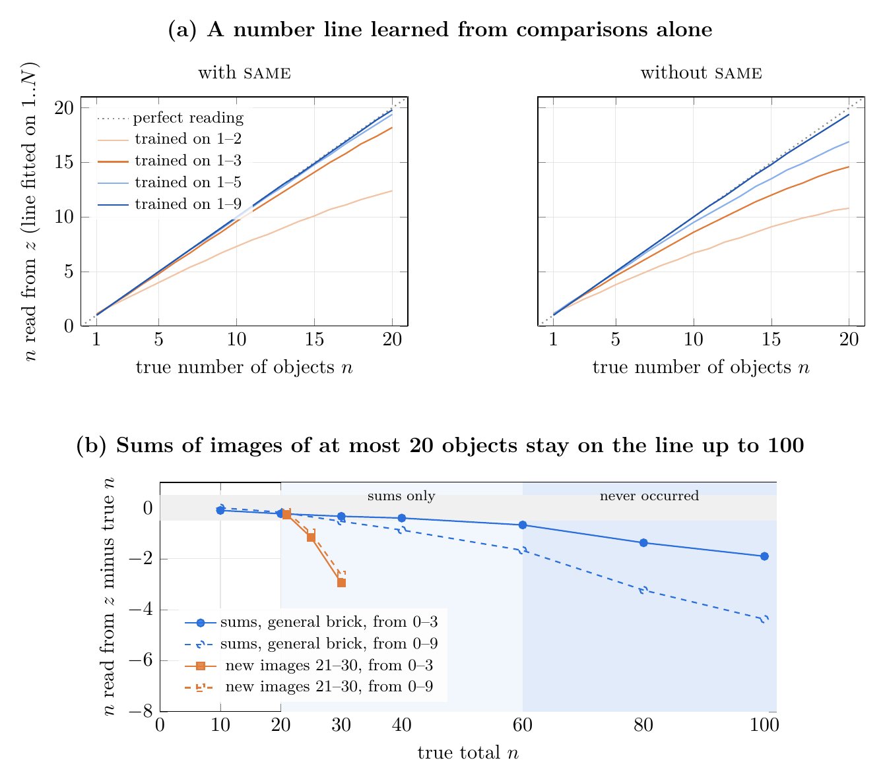

# Seeing numbers by comparison

**Can a network discover numbers and addition if all it ever learns is to judge whether one image holds more, the same, or fewer objects than another?**

A small convolutional encoder maps an image to a single value $z$. A comparison head, trained only on the three labels *more / same / fewer*, compares two such values. No number label is used, and no target value or difference head is imposed. We then teach addition the same way: a small recurrent brick folds a sequence of images joined by "+" into a value, and the same head compares sums against images and against other sums.

## Key results

- **A linear number line emerges from comparisons alone.** $z$ is a sum of local object detectors. The main experiments use a 4,925-parameter encoder, and the comparison still holds with 395 parameters (99.6% on 1 to 9). The noise grows as $\sqrt{n}$.
- **Judging "same" is what makes the line extrapolate.** Trained on 1 to 3 objects, the network still reads about 10 correctly when the equality class is used, against about 5 without it. A transformer reading the same latents fails to extrapolate.
- **Addition learned as a comparison.** Sums align with the image scale ($[10]+[10]$ reads as 19.9), commutativity emerges without being imposed, and judgments generalise to unseen expression lengths (4 to 6 terms).
- **Values beyond anything perceived.** No image ever holds more than 20 objects, yet sums stay on the image line up to 100 (100 reads as 98.1), including totals that never occur even as sums.
- **New percepts land on the value line.** When images of 21 to 30 objects are learned later, with the addition brick still training, images up to about 25 come to be judged equal to sums of the same total (about 85 to 90%), although they were never compared to a sum. Beyond that, reading of the most crowded images plateaus.
- **Subtraction and its limit.** Subtraction is learned the same way without displacing addition ($10-4$ reads as 6.0), but running values below zero, never met in training, fail from 3 below zero: the line ends at the empty image.



*(a) The latent value converted to a number of objects, for networks trained on 1 to N objects, with and without the "same" judgment. (b) Reading error of sums of images up to totals of 100, and of new images of 21 to 30 objects.*

## Repository layout

| Path | Content |
|---|---|
| `generate*.py` | synthetic stimuli (separated shapes on a black background, 64×64 and 192×192) |
| `run.py`, `compare.py`, `plage.py`, `reduction.py` | comparison training, range experiments, encoder size reduction |
| `addition.py`, `expressions.py`, `expressions_moins.py` | the addition brick, expressions with "+" and "−" |
| `au_dela_20*.py` | experiments on values above 20 |
| `logs/` | text summaries of every series |

## Reproduce

See [`REPRODUCE.md`](REPRODUCE.md): one command per experiment, with run times on a single consumer GPU (12 GB).

```bash
uv sync
```

## Status

This is ongoing research. The numbers are preliminary (3 seeds per condition). Next steps: identical optimiser settings across the 1-100 series, at least 5 seeds, a supervised baseline of the same size, and a larger encoder for the plateau above 25.

## Related project

[counting-is-pointing](https://github.com/Delata22/counting-is-pointing): an agent that learns to count by pointing at objects one by one and saying number words.

## License

MIT, © 2026 Gurvan Estable.

---

*Implemented with the help of AI coding assistants; the concepts, experiments and intuitions are mine.*
